

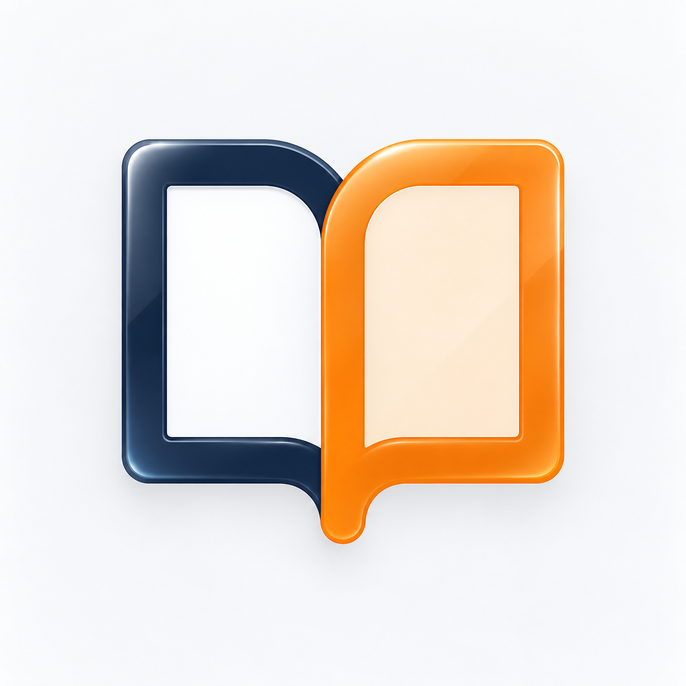

# KPSSODAK

### 🎯 Hazırlığını gör. Eksiklerini tamamla. Hedefine odaklan.

Soru çözümü, deneme, haritayla öğrenme ve çalışma takibi tek uygulamada.

<a href="https://apps.apple.com/tr/app/kpss-odak/id6816253961?l=tr">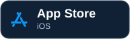</a>&nbsp;&nbsp;

&nbsp;
&nbsp;
&nbsp;
<a href="docs/architecture.md">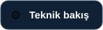</a>

 

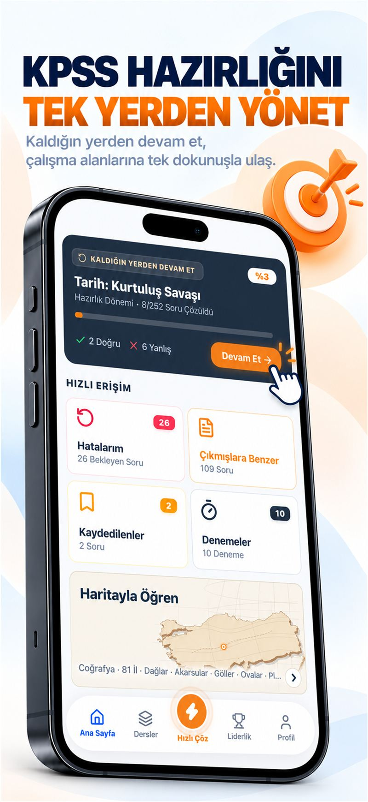&nbsp;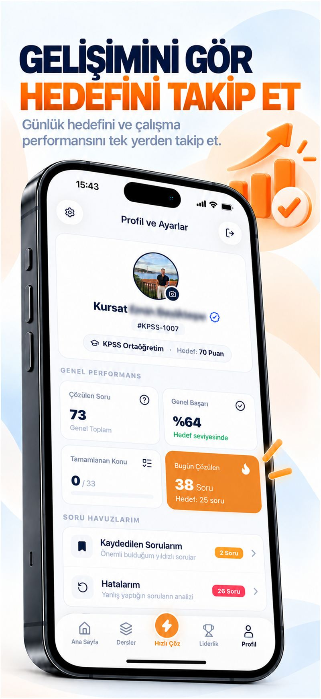

📱&nbsp;iPhone&nbsp;ve&nbsp;Android &nbsp;&nbsp; ✍️&nbsp;Telefon&nbsp;ve&nbsp;tablet &nbsp;&nbsp; 🇹🇷&nbsp;Türkçe&nbsp;deneyim

---

## 🌟 Bir soru uygulamasından daha fazlası

Ne çözeceğini aramakla, yanlışlarını toplamakla veya nerede kaldığını hatırlamakla vakit kaybetme. KPSSODAK hazırlığının her adımını aynı yerde tutar:

📚 **Konunu seç** &nbsp;➜&nbsp; 💡 **Çöz ve öğren** &nbsp;➜&nbsp; 🔁 **Yanlışlarına dön** &nbsp;➜&nbsp; ⏱️ **Denemede ölç** &nbsp;➜&nbsp; 📈 **İlerlemeni gör**

## 🧭 Uygulama turu

<table>
<tr>
<td width="33%" valign="top">📚 <a href="#konular"><strong>Dersler ve konular</strong></a> Ders, konu ve alt konu düzeninde ilerle</td>
<td width="33%" valign="top">💡 <a href="#soru-cozumu"><strong>Soru çözümü</strong></a> Cevabını gör, çözümün mantığını öğren</td>
<td width="33%" valign="top">🔁 <a href="#tekrar"><strong>Hatalar ve özel test</strong></a> Yanlışlarını yeni bir çalışmaya çevir</td>
</tr>
<tr>
<td valign="top">⏱️ <a href="#denemeler"><strong>Denemeler</strong></a> Genel ve branş denemeleriyle kendini ölç</td>
<td valign="top">🗺️ <a href="#harita"><strong>Haritayla Öğren</strong></a> 81 il ve coğrafi hedefleri haritada bul</td>
<td valign="top">✍️ <a href="#tablet"><strong>Tablette yazarak çöz</strong></a> İşlemini sorunun üzerinde yap</td>
</tr>
<tr>
<td valign="top">🔥 <a href="#motivasyon"><strong>Seri ve liderlik</strong></a> Günlük hedefle düzenini koru</td>
<td valign="top">📅 <a href="#hedef"><strong>Hedef ve takvim</strong></a> Sınavına kalan günü takip et</td>
<td valign="top">👤 <a href="#hesap"><strong>Profil ve destek</strong></a> Hesabını ve üyeliğini yönet</td>
</tr>
</table>

---

## 📚 Ne çalışacağını bilerek başla

Tarih, Coğrafya, Türkçe, Matematik, Vatandaşlık ve Güncel Bilgiler; ders → konu → alt konu düzeninde.

- 🏠 **Ana sayfa:** Çözdüğün soruları, doğru–yanlış sayını ve başarını bir arada gör.
- ▶️ **Kaldığın yerden devam:** Son çalışmana tek dokunuşla dön.
- 📊 **Konu ilerlemesi:** Tamamladığın ve sıradaki başlıkları gör.
- 🔀 **Konu veya karışık çözüm:** Tek başlığa odaklan ya da alanını genişlet.
- ⚡ **Hızlı çözüm:** Farklı konulardan, önce çözmediğin sorularla başla.
- 🎛️ **Sınav ve yıl filtreleri:** Hangi yılda kaç soru olduğunu görerek listeyi daralt.
- 📝 **Çıkmışlara benzer sorular:** Sınav tarzında hazırlanmış özgün sorularla çalış.

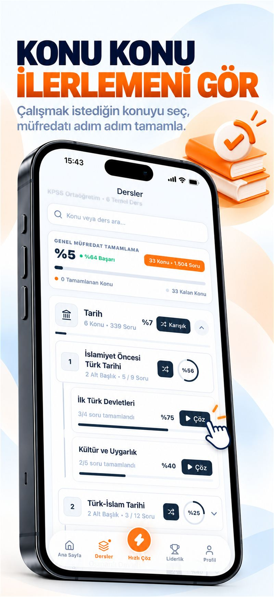&nbsp;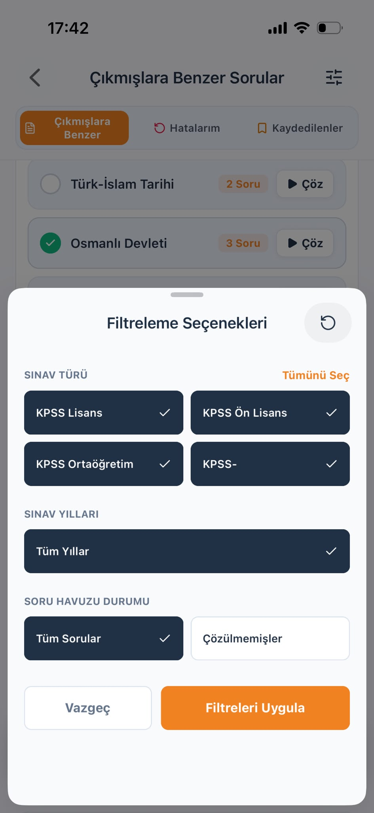

## 💡 Cevabı işaretle, mantığını öğren

Yanıtının sonucunu hemen gör, açıklamayı açarak nedenini incele.

- 📖 **Açıklamalı çözüm:** Soru, şıklar ve çözüm aynı ekranda.
- 🧮 **Okunaklı içerik:** Kalın ve italik vurgular, görseller ve matematiksel gösterimler.
- 🔢 **Soru numaraları:** Sorular arasında gez, doğru ve yanlışlarını bir bakışta gör.
- 📊 **Soru istatistikleri:** Doğru çözülme oranını ve şıkların nasıl işaretlendiğini incele.
- 🔖 **Kaydet:** Tekrar dönmek istediğin soruyu ayır.
- 🚩 **Bildir:** Hatalı gördüğün soruyu doğrudan ilet.
- 🏁 **Oturum özeti:** Çalışma sonunda doğru–yanlış durumunu, süreni ve kazandığın puanı gör.

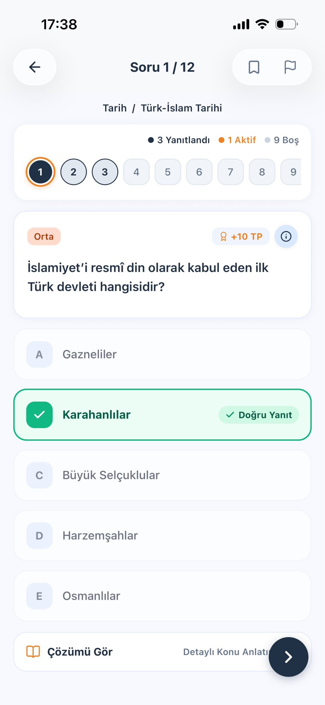&nbsp;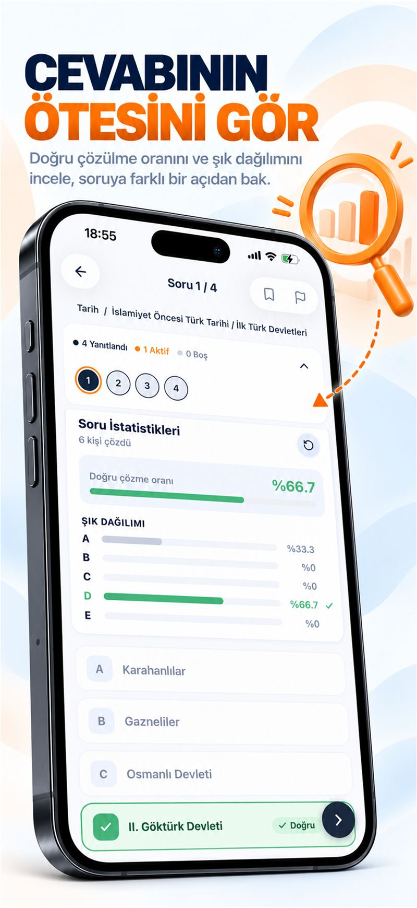

## 🔁 Yanlışlarını bir sonraki çalışmana dönüştür

Geniş havuzda dolaşmak yerine ihtiyacın olan sorularla çalış.

- ❌ **Hatalarım:** Yanlış yanıtladığın sorular ders ve konu bazında toplanır. Doğru çözdüğünde listedeki durumu güncellenir.
- 🔖 **Kaydedilenler:** Ayırdığın sorular kişisel listende kalır.
- 🧩 **Özel Test Oluştur:** Farklı başlıkları birleştir; konulara, hatalarına veya kaydettiklerine odaklan.

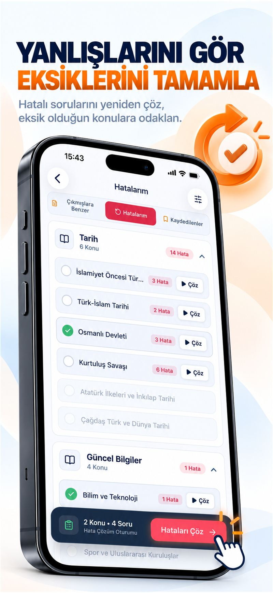&nbsp;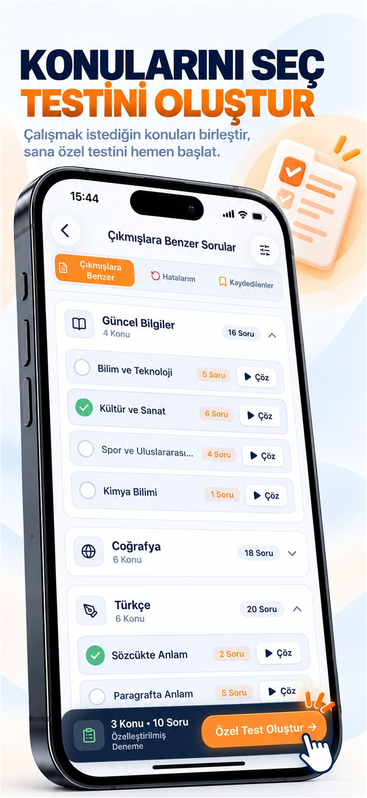

## ⏱️ Sınavdan önce kendini dene

Bütün sınavı ya da tek bir dersi çalış. Zaman yönetimi için süreli, öğrenmek için süresiz başla.

- 🗂️ **Deneme kataloğu:** Genel ve branş denemelerini, önceki performansını incele.
- ▶️ **Devam edebilme:** Yarım kalan denemene izin verilen akışta geri dön.
- ⏳ **Gerçek süre:** Uygulamadan çıksan da süreli denemenin zamanı işlemeye devam eder.
- ✏️ **Rahat gezinme:** Cevabını değiştir, boşalt, soruyu işaretle ve boş bıraktıklarını kontrol et.
- 🎯 **Ayrıntılı sonuç:** Doğru, yanlış, boş, net, puan ve süreni toplamda ve ders bazında gör.
- 🔍 **İnceleme:** Yanıtlarına ve izin verilen çözümlere geri dön.
- 🔄 **Yeniden çöz:** Hakkın varsa denemeyi yeniden çöz; eski sonuçların ayrı kalır.

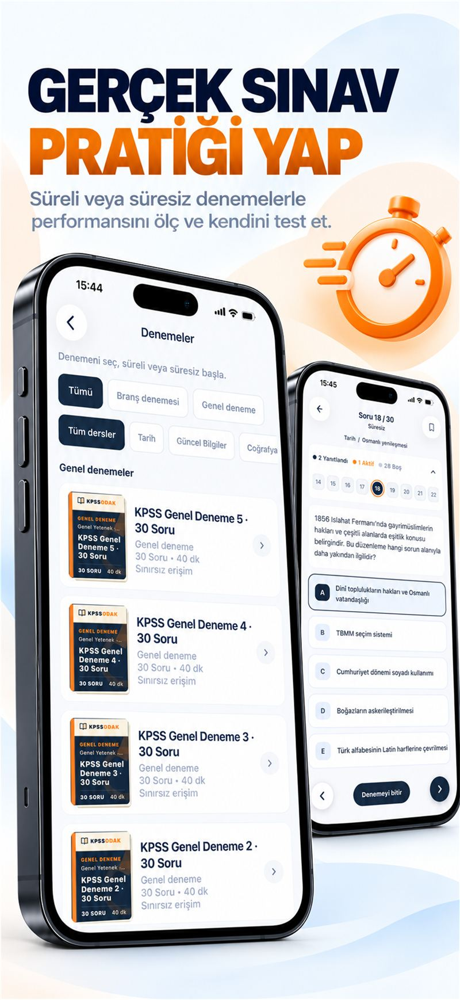

## 🗺️ Coğrafyayı yerini bularak öğren

Türkiye haritasında **81 ili** ve coğrafi hedefleri çalış; cevap kartını doğru konuma sürükle.

- 🏔️ **Kategoriler:** Dağ, akarsu, göl, ova, plato ve diğer coğrafya başlıkları.
- 🌾 **Tematik çalışma:** Ulaşım, çevre, hayvancılık, kalkınma projeleri ve yağış gibi kapsamlar.
- 📍 **Farklı hedef türleri:** Nokta, akarsu çizgisi, bölge ve birden fazla ile bağlı hedefler.
- 🔎 **Rahat gezinme:** Haritayı yakınlaştır, taşı; il adlarını ve komşu ülkeleri tercihine göre göster.
- 💡 **İpucu:** Takıldığında cevabı gör. İpucuyla açılan hedef doğru cevap sayılmaz.
- 🏆 **Tur takibi:** Doğru–yanlışlarını ve kalan hedefleri gör, turu baştan başlat.
- 📖 **Coğrafya Atlası:** İl ve kategori bilgilerini, kaynak bağlantılarıyla incele.
- ❓ **Haritalı sorular:** Harita üzerinde çoktan seçmeli sorular çöz.

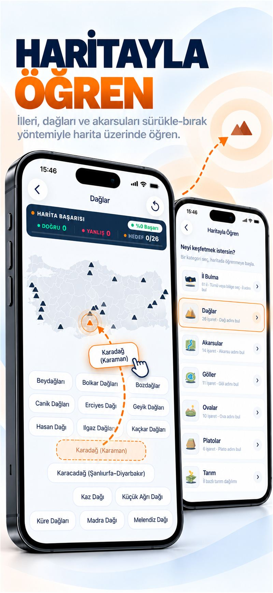&nbsp;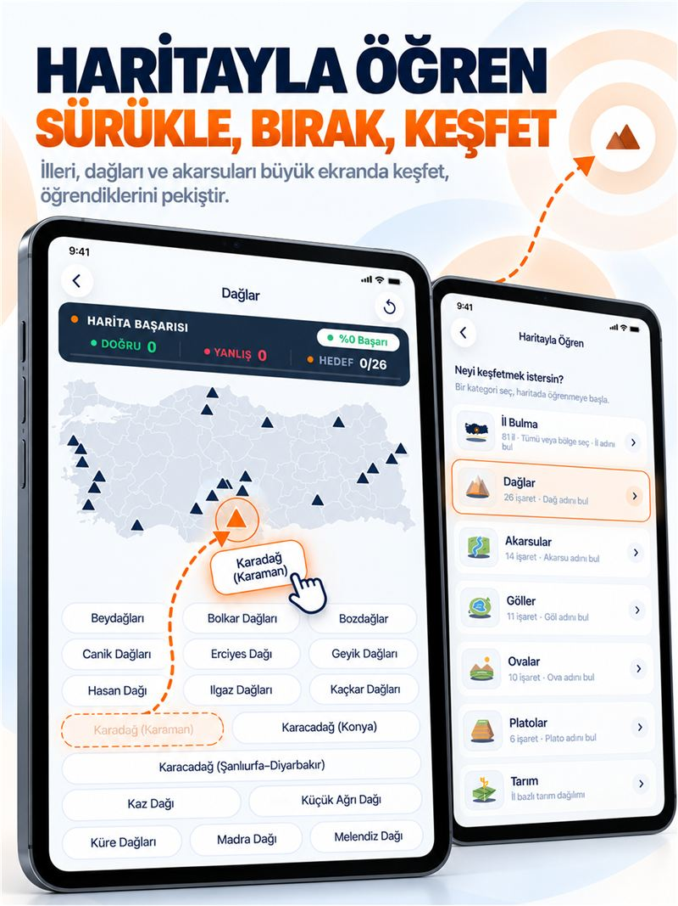

## ✍️ Düşünceni sorunun üzerine taşı

Desteklenen tablet modunda işlemini kâğıttaki gibi sorunun üzerinde yap.

- 🖊️ **Araçlar:** Kalem, fosforlu kalem ve silgi; renk ve kalınlık seçimi.
- 🖐️ **Gezinme modu:** Soru kâğıdını taşı ve yakınlaştır.
- 🔠 **Yazarken cevapla:** A–E harf kutularına dokunarak şıkkını işaretle.
- 🎚️ **Sana göre ayarlar:** Araç, renk, boyut ve kontrol düğmesinin yeri hesabında hatırlanır.
- 💾 **Kalıcı notlar:** Karalamaların cihazında saklanır ve sunucuya gönderilmez. Aynı soruya döndüğünde seni bekler.
- 🗃️ **Güvenli geçiş:** Soru değişirse eski notun yeni metnin üstüne binmez; önceki çalışmana arşivden bakabilirsin.

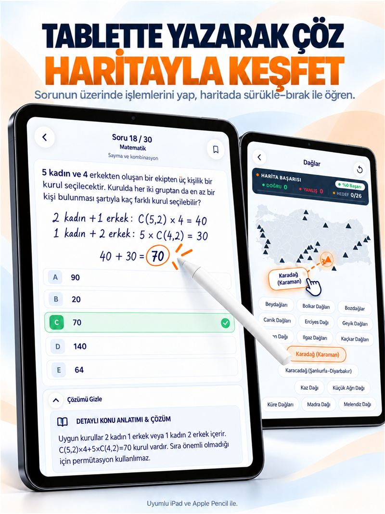

> [!NOTE]
> Kalem, parmakla yazma ve çoklu dokunma davranışları cihaza ve uygulama sürümüne bağlıdır. Görseller kullanım örneğidir; her sürümde aynı araç ve hareketlerin bulunduğu anlamına gelmez.

## 🔥 Motivasyonunu çalışma düzenine çevir

- 🎯 **Günlük hedef:** Soru hedefini belirle, gün içindeki ilerlemeni izle.
- 📆 **Çalışma takvimi:** Çalıştığın, dondurduğun ve hedefini tamamladığın günleri ay ay gör.
- 🔥 **Çalışma serisi:** Mevcut serini, en uzun serini ve toplam aktif gününü takip et.
- 🛡️ **Dondurma kalkanı:** Çalışamadığın günde, hakkın varsa serin otomatik korunur.
- ⭐ **TP puanı:** İlk cevabında doğru bildiğin sorudan puan kazan; orta ve zor sorular ek puan getirir.
- 🎁 **Günlük bonus:** Hedefini tamamladığında doğruluğuna ve serine göre bonus al.
- 🏆 **Liderlik:** Haftalık ve tüm zamanlar sıralamasında yerini gör.

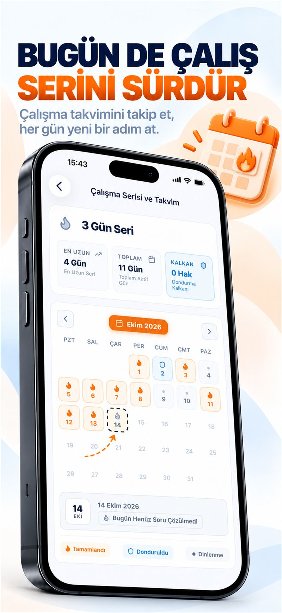&nbsp;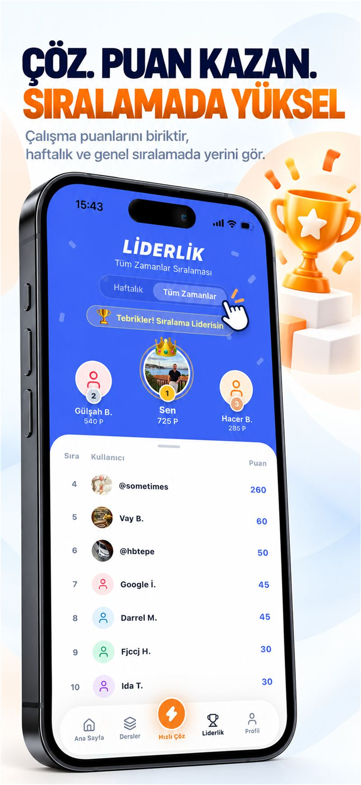

> [!TIP]
> TP bir çalışma ödülüdür; deneme neti veya resmî KPSS puanı değildir. Yanlış cevap kesintisinde toplam puanın sıfırın altına düşmez.

## 📅 Sınavın hep gözünün önünde

- 🎓 **Hedef sınav ve puan:** Hazırlandığın sınavı ve ulaşmak istediğin puanı belirle.
- ⏰ **Geri sayım:** Sınavına kalan süreyi takip et.
- 🗓️ **Sınav takvimi:** Yaklaşan sınavları ve tarihlerini gör. Tahmini tarihler kesin tarihlerden ayrı gösterilir.

## 👤 Hesabın, üyeliğin ve destek

- 🔐 **Giriş:** E-posta ve şifre, desteklenen cihazlarda Apple ve Google.
- 🔑 **Hesap güvenliği:** E-postana gelen kodla şifreni sıfırla; Apple veya Google hesabını bağla.
- 🖼️ **Profil:** Adını, kullanıcı adını ve fotoğrafını düzenle.
- 🌗 **Tema:** Çalışma ortamına göre açık veya koyu görünüm.
- 💎 **Üyelik:** Paketlerini ve Premium erişimini incele, satın alımını geri yükle, uygun erişim kodlarını kullan.
- 💬 **Destek merkezi:** Talep oluştur, yanıtı uygulamada oku ve aynı talepte yazışmayı sürdür.
- 🔄 **Güncellemeler:** Uyumlu güncellemeler açılışta otomatik uygulanır, çalışmanı yarıda kesmez.
- 🗑️ **Hesap silme:** Hesabını Profil üzerinden sil. Mağaza aboneliğini ayrıca mağazadan iptal etmelisin.

> [!NOTE]
> Özellik ve içerik erişimi seçilen pakete, içerik ayarlarına ve uygulama sürümüne göre değişebilir. Ekranlardaki kişi, sayı ve katalog bilgileri görsellerin hazırlandığı döneme aittir.

---

## 🖥️ Perde arkasındaki yönetim paneli

Öğrencinin gördüğü ders, soru, harita ve denemeler web panelinden yönetilir.

| | Alan | Neler var |
| --- | --- | --- |
| 📝 | **İçerik** | Müfredat, soru bankası, LaTeX formül düzenleyici, mobil önizleme, denemeler ve sınav takvimi |
| 🗺️ | **Haritalar** | Kategori kartları, noktaları sürükleyerek konumlama, yeni hedef ekleme, görünüm ve erişim ayarları |
| 👥 | **Operasyon** | Kullanıcılar ve roller, üyelikler, erişim kodları, satışlar, soru bildirimleri, destek talepleri, liderlik ve seri ayarları |
| 🛡️ | **Güvenlik ve izleme** | İşlem geçmişi, hata izleme paneli, taslak ve çakışma koruması |

🖼️ <strong>Panelin örnek görünümünü aç</strong>

 
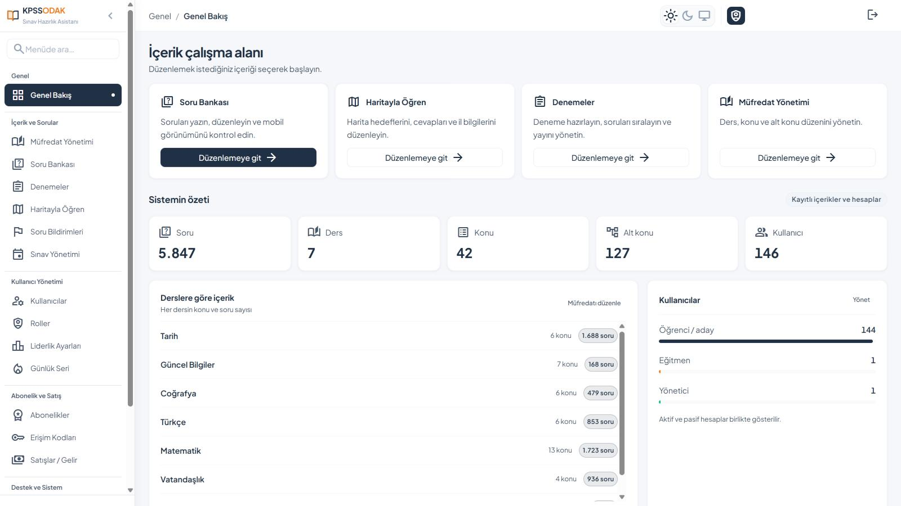

*Görsel, yönetim deneyimini tanıtır; yönetim erişimi veya proje dosyası paylaşılmaz.*

## ⚙️ Teknik tarafı merak edenlere

Mobil uygulama, yönetim paneli ve ortak servislerin nasıl bir araya geldiğini **[ürün mimarisi özetinde](docs/architecture.md)** okuyabilirsin.

> [!NOTE]
> Bu depo portföy amaçlı ürün tanıtımıdır. Kaynak kod, kurulum rehberi, özel belgeler ve üretim ayarları paylaşılmaz.

---

### 🚀 Küçük bir çalışma. Görünür bir ilerleme.

&nbsp;&nbsp;

Bağımsız bir sınav hazırlık projesidir; ÖSYM ile resmî bağlantısı yoktur. “Çıkmışlara benzer” ifadesi birebir geçmiş sınav sorusu anlamına gelmez.

