
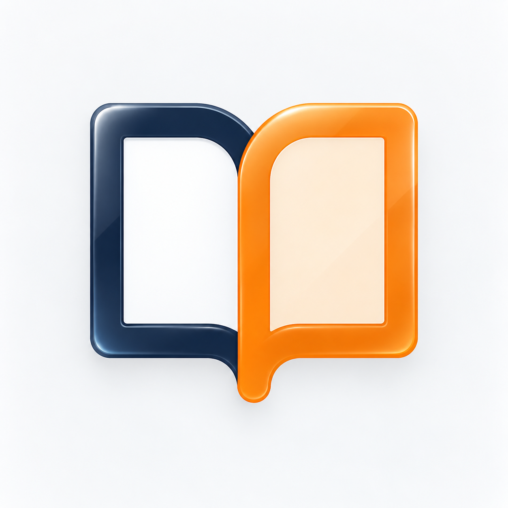

<h1 align="center">KPSSODAK</h1>

<strong>Hedefin belli. Odağın burada.</strong>

Haritada öğren, açıklamalı sorularla pekiştir, kendi testini oluştur ve gelişimini takip et.

<a href="https://apps.apple.com/tr/app/kpss-odak/id6816253961?l=tr">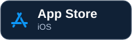</a>

<a href="https://kpssodak.runasp.net/">Uygulamayı keşfet</a> · <a href="#uygulamadan-görünümler">Ekranlara göz at</a> · <a href="#sık-sorulanlar">Sık sorulanlar</a>

## Hazırlığını tek yerden yönet

Neyi çalışacağını, hangi konuları tekrar etmen gerektiğini ve ne kadar ilerlediğini bir arada gör. KPSSODAK; Türkçe, Matematik, Tarih, Coğrafya, Vatandaşlık ve Güncel Bilgiler çalışmalarını günlük hedeflerinle buluşturur.

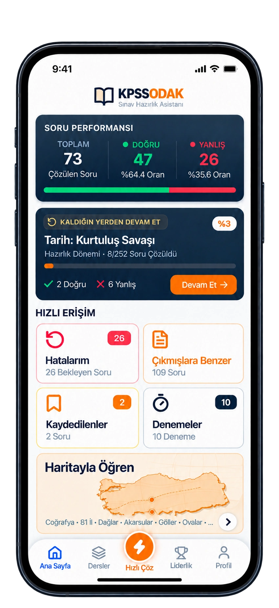

## Sana uygun çalışma yolunu seç

| Çalışma alanı | Sana ne kazandırır? |
| --- | --- |
| **Haritayla Öğren** | Türkiye'nin 81 ilini ve coğrafi hedefleri haritada çalış; uygun etkinliklerde cevap kartını hedefe sürükleyip bırak veya hedefe dokun. |
| **Açıklamalı soru çözümleri** | Cevabının ardından çözümün mantığını incele, eksik kalan bilgini pekiştir. |
| **Ders, konu ve alt konu seçimi** | İhtiyacın olan başlığa odaklan; konu ilerlemeni ve kalan sorularını takip et. |
| **Kendi testini oluştur** | Konularını, yanlışlarını veya kaydettiğin soruları seçerek kişisel tekrarını planla. |
| **Genel ve branş denemeleri** | Süreli veya süresiz çalış; doğru, yanlış, boş, net ve ders bazındaki sonuçlarını değerlendir. |
| **Hızlı Çöz ve soru filtreleri** | Karışık pratik yap; ilgili havuzlarda ders, konu, sınav, yıl ve çözüm durumuna göre soru seç. |
| **Soru üzerine yazma** | Desteklenen cihaz ve uygulama sürümünde işlemlerini sorunun üzerinde yap, not al ve önemli yerleri vurgula. |
| **Hedef, takvim ve geri sayım** | Uygulamada sunulan hedef sınavını seç, kalan süreyi ve günlük çalışma düzenini izle. |
| **Çalışma serisi ve liderlik** | Aktif günlerini gör, dondurma kalkanı haklarını takip et ve çalışma puanlarınla sıralamada ilerle. |

## Uygulamadan görünümler

### Haritada keşfet, konunu seç, kendi testini kur

<table>
<tr>
<td align="center" width="33%">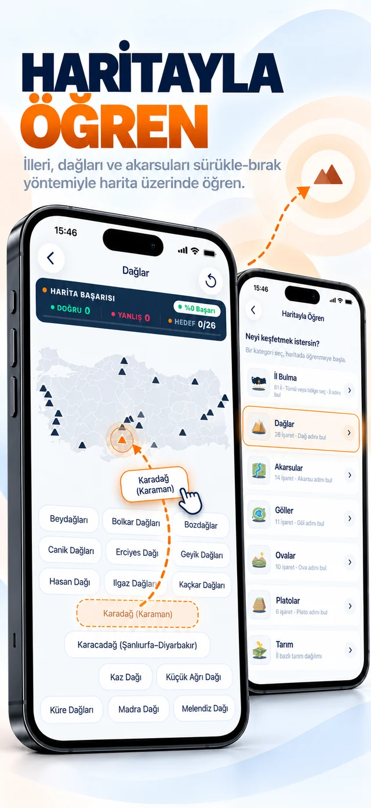 <strong>Haritayla Öğren</strong></td>
<td align="center" width="33%">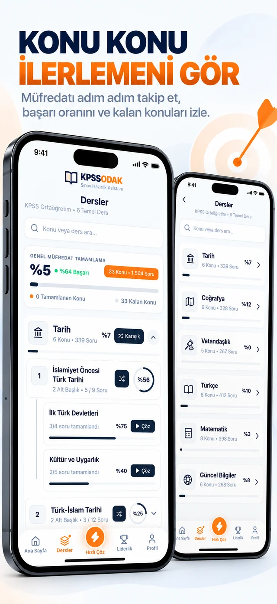 <strong>Konu konu ilerle</strong></td>
<td align="center" width="33%">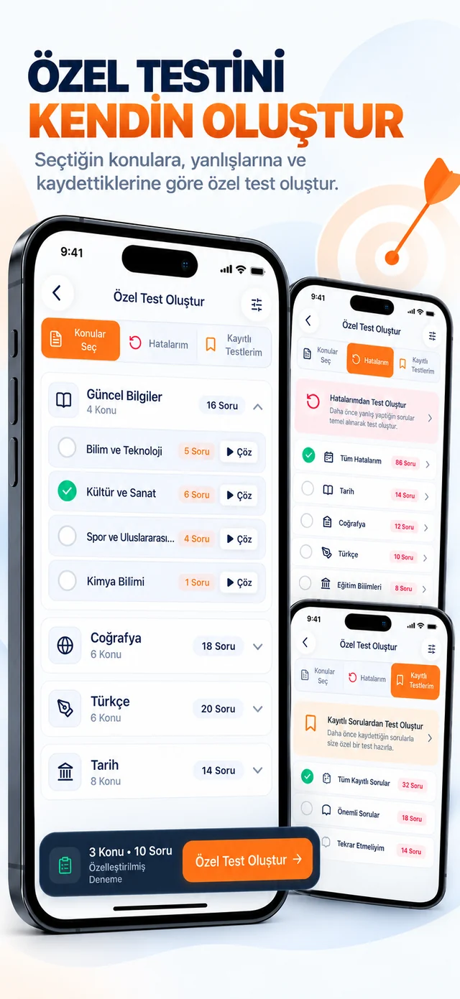 <strong>Testini kendin oluştur</strong></td>
</tr>
</table>

Haritayla Öğren'de illerin yanında dağ, akarsu, göl, ova ve plato gibi coğrafi hedeflerle çalış. Haritayı yakınlaştır, ipuçlarından yararlan ve yeni turlarla öğrendiklerini pekiştir. Coğrafya atlasında il bilgilerine ve kaynak bağlantılarına ulaş.

### Yanlışlarını öğrenmeye çevir

<table>
<tr>
<td align="center" width="33%">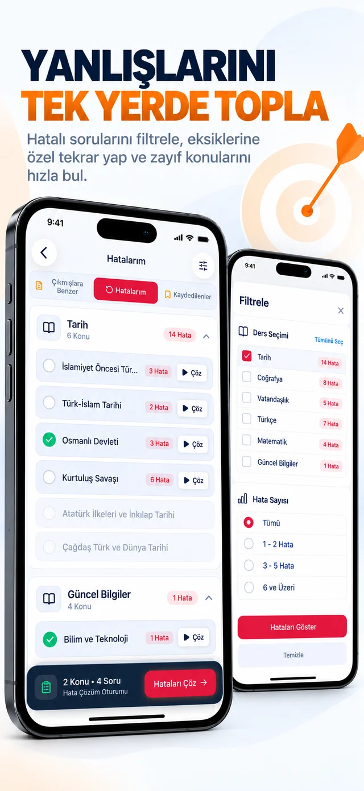 <strong>Eksiklerine geri dön</strong></td>
<td align="center" width="33%">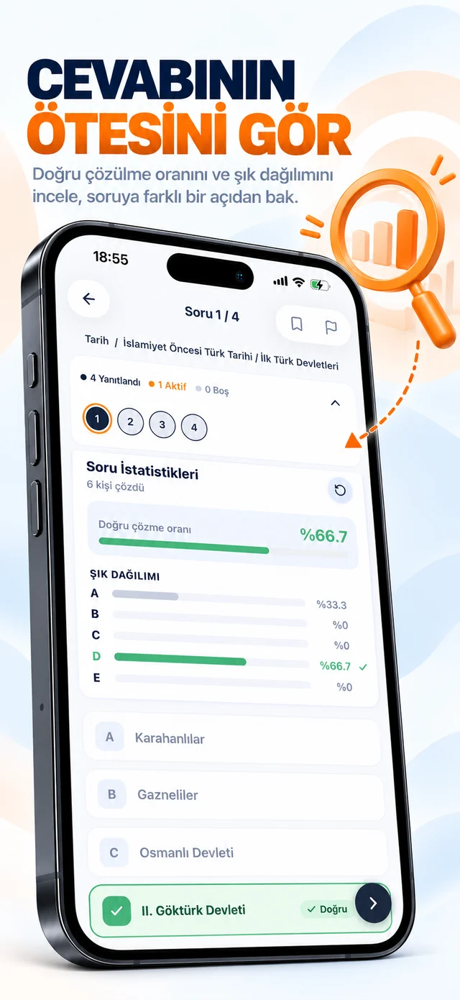 <strong>Cevabının ötesini gör</strong></td>
<td align="center" width="33%">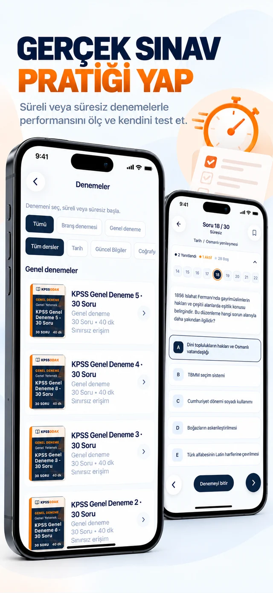 <strong>Sınavdan önce kendini dene</strong></td>
</tr>
</table>

Yanlış yaptığın soruları Hatalarım'da bir araya getir; önemli soruları kaydederek daha sonra yeniden çalış. Denemelerinde soruları işaretle, kuralları izin veren oturumuna kaldığın yerden devam et. Tamamladığında ders bazındaki analizini incele; çözüm görüntüleme ve yeniden çözme seçenekleri denemenin kurallarına bağlıdır.

### Her gün bir adım daha

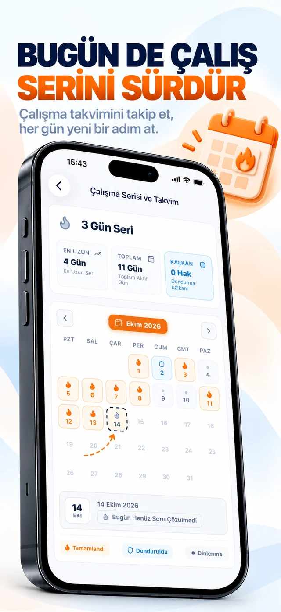
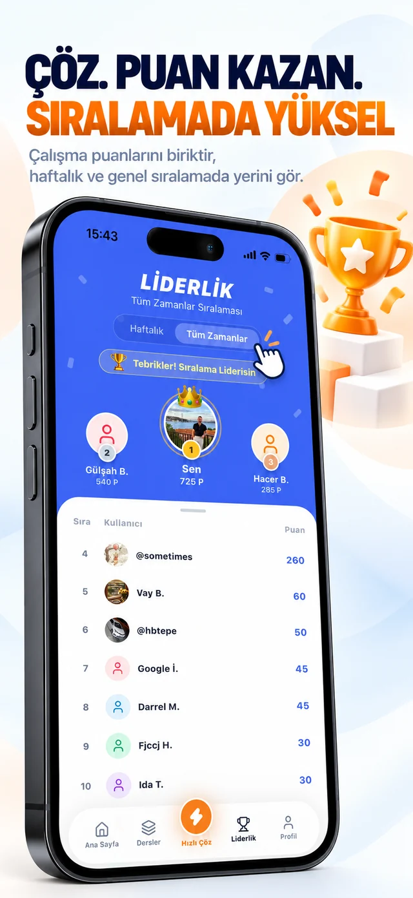

Günlük soru hedefini belirle, çalışma serini takvimden izle ve dondurma kalkanı haklarınla ara verdiğin günlerde serini koru. Uygun çalışmalarla TP kazan; haftalık ve tüm zamanlar sıralamasında yerini gör. **TP çalışma puanıdır; resmî KPSS puanı değildir.**

## Sorunun üzerine yazarak çalış

Kalem, işaretleyici ve silgiyle işlemlerini aynı soru üzerinde yap. Çalışma alanını yakınlaştırıp taşı, önemli noktaları vurgula ve soruya döndüğünde cihazında saklanan notlarını yeniden aç.

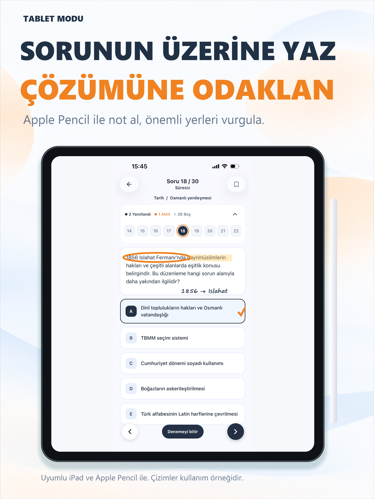

Soru üzerine yazma modu profil ayarlarından açılır. Kullanılabilirlik cihaz, giriş yöntemi ve uygulama sürümüne bağlıdır; uyumlu iPad ve Apple Pencil desteği bulunur. **Çizimler cihazda saklanır; buluta veya başka cihazlara eşitlenmez.** Bu görsel bir kullanım tanıtımıdır.

## Güncel deneyimde neler var?

- **Daha kapsamlı hedef sınav seçimi:** Uygulamada sunulan aktif sınav takvimlerini, DGS dahil yeni hedefleri ve geri sayımı aynı yerden takip et. Yaklaşık tarihler uygulamada ayrıca belirtilir.
- **Daha verimli içerik erişimi:** Desteklenen Android sürümlerinde, daha önce alınmış değişmeyen içerikler cihazda yeniden kullanılabilir. Çalışma hakları ve cevap değerlendirmesi sunucuda doğrulanmaya devam eder; internet bağlantısı gerekir.
- **Güncel paket erişimi:** Paket kapsamını uygulama içinden incele; erişim değişiklikleri desteklenen sürümlerde yenilenir. Satın alımlarını mağazanın geri yükleme seçeneğiyle kontrol edebilirsin.
- **Daha düzenli çalışma alanları:** Ders ve konu kartları, soru istatistikleri, deneme sonuçları ve açık/koyu tema ile çalışmanı takip et.
- **Güvenli güncelleme akışı:** Uyumlu uygulama güncellemeleri açılış sırasında uygulanır; aktif soru veya deneme çalışması sırasında uygulama kendiliğinden yeniden başlatılmaz.

## Sık sorulanlar

### Uygulama ücretsiz mi?

Uygulama ücretsiz indirilebilir. Özelliklere, soru havuzlarına ve çözüm haklarına erişim paketine ve içerik kurallarına bağlı olabilir. Güncel fiyatları, aylık/yıllık seçenekleri ve kapsamı uygulamadaki Paketler ekranından inceleyebilirsin.

### Çıkmışlara Benzer bölümünde resmî çıkmış sorular mı var?

Bu bölüm sınav tarzına uygun özgün çalışma soruları sunar; resmî çıkmış soru arşivi değildir. KPSSODAK'ın ÖSYM veya herhangi bir kamu kurumuyla resmî bağlantısı yoktur.

### İnternet olmadan bütün soruları çözebilir miyim?

Hayır. Cihazdaki içerik saklama özelliği tam çevrimdışı soru bankası anlamına gelmez. Oturum, erişim, çözüm hakkı, cevap ve ilerleme işlemleri için internet bağlantısı gerekir.

### Bir soruda hata görürsem veya yardıma ihtiyacım olursa ne yapabilirim?

Sorudaki bildirme seçeneğini veya uygulama içindeki destek merkezini kullanabilirsin. Hesap ve uygulama desteği için [destek sayfasına](https://kpssodak.runasp.net/support.html) da ulaşabilirsin.

### Ekrandaki soru sayıları ve ilerleme değerleri güncel mi?

Görseller örnek çalışma verilerini ve hazırlandıkları tarihteki ekranları gösterir. Katalog, sınav tarihleri ve paket kapsamı değişebilir; uygulamadaki güncel bilgileri esas al. Özelliklerin kullanılabilirliği platform ve sürüme göre farklılık gösterebilir.

---

<strong>Çöz. Haritada öğren. Gelişimini gör.</strong>

<a href="https://play.google.com/store/apps/details?id=com.bksstudio.kpssodak">Google Play</a> · <a href="https://apps.apple.com/tr/app/kpss-odak/id6816253961?l=tr">App Store</a> · <a href="https://kpssodak.runasp.net/privacy.html">Gizlilik</a> · <a href="https://kpssodak.runasp.net/terms.html">Kullanım koşulları</a>

KPSSODAK sınav sonucu veya puan garantisi vermez. Deneme puanları resmî KPSS puanı değildir.

[Ürün altyapısı ve güncel mimari](docs/architecture.md) · [Görsel kaynakları](assets/README.md)
