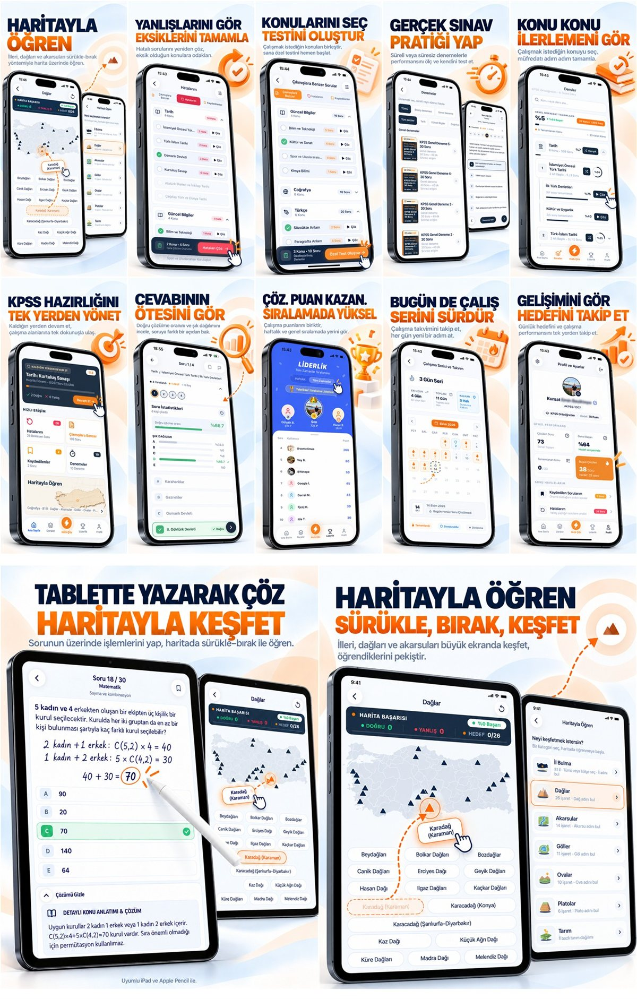

# 📚 KPSSODAK
### *Sınav Hazırlık Asistanı*

 

  <strong>5.000+ Soru &nbsp;·&nbsp; İnteraktif Coğrafya Haritası &nbsp;·&nbsp; Tablet Kalem Desteği &nbsp;·&nbsp; Akıllı Sınav Sistemi</strong>

---

### 🌟 Uygulama Vitrini

---

## 🎯 KPSSODAK Nedir?

**KPSSODAK**, kamu personeli seçme sınavlarına hazırlanan adaylar için baştan sona modern teknolojilerle geliştirilmiş **yeni nesil, akıllı bir sınav hazırlık platformudur.** 

Standart test kitaplarının ötesine geçerek; interaktif harita üzerinde coğrafya öğrenimi, tablet ve kalemle soru üzerinde işlem yapma, kişiselleştirilmiş eksik giderme algoritmaları ve oyunlaştırılmış çalışma serileri ile öğrenme verimini en üst seviyeye taşır.

> 📱 **Tek Ekosistem:** iOS (App Store), Android (Google Play), Web Yönetim Portalı ve Tanıtım Sitesi.

---

## ✨ Öne Çıkan Kullanıcı Özellikleri

### 🗺️ 1. Haritayla Öğren — Sürükle, Bırak, Keşfet!

Coğrafyayı ezberlemek yerine interaktif olarak keşfet! Türkiye haritası üzerinde coğrafi hedefleri sürükle-bırak yöntemiyle öğrenin veya dokunarak hedefleri bulun.

<table>
  <tr>
    <td align="center" width="50%">
       
      <em>📱 Telefon Görünümü — Hedef Bulma & Sürükleme</em>
    </td>
    <td align="center" width="50%">
       
      <em>💻 Tablet Görünümü — Geniş Ekran İnteraktif Harita</em>
    </td>
  </tr>
</table>

- 🏔️ **Zengin Coğrafi Katalog:** 81 İl, Dağlar, Akarsular, Göller, Ovalar, Platolar, İklim ve Tarım dağılımları.
- 🎯 **4 Farklı Hedef Türü:** Noktasal hedefler, akarsu çizgileri, alan bölgeleri ve çoklu il bağlantıları.
- 🔍 **Coğrafya Atlası:** İl bazında kategori, detaylı bilgi kartları ve güvenilir kaynak referansları.
- 🧩 **Haritalı Soru Deneyimi:** Harita görünümlü interaktif çoktan seçmeli soru ve cevap akışı.

---

### ✏️ 2. Tablette Kalemle Çöz — Fiziksel Sınav Deneyimi

Sınav kâğıdında yaptığınız gibi soru üzerinde karalama yapın, formülleri çözün ve önemli yerleri fosforlu kalemle çizin!

  

- ✍️ **Tam Donanımlı Çizim Seti:** Kurşun kalem, fosforlu işaretleyici ve hassas silgi.
- ⚡ **Native Performans:** iOS tarafında **Apple PencilKit**, Android tarafında **Ink API** entegrasyonu ile sıfır gecikme.
- 🔄 **Geçmiş Yönetimi:** Geri Al (Undo) / İleri Al (Redo) ve yakınlaştırma/kaydırma hareketleri.
- 🔒 **Kişisel Not Güvenliği:** Çizimler tamamen cihazınızda saklanır, soruya geri döndüğünüzde anında yüklenir.

---

### 🧠 3. Akıllı Soru Bankası & Konu İlerlemesi

Tüm KPSS Genel Yetenek & Genel Kültür müfredatı parmaklarınızın ucunda.

<table>
  <tr>
    <td align="center" width="33%">
       
      <strong>📚 Konu Takibi</strong> 
      Müfredatta adım adım ilerleme ve kalan soru oranları
    </td>
    <td align="center" width="33%">
       
      <strong>⚡ Özel Testini Kur</strong> 
      İstediğin ders ve konuları seç, kişisel testini üret
    </td>
    <td align="center" width="33%">
       
      <strong>🔄 Hatalarını Gör</strong> 
      Yanlış yapılan soruları tekrar çöz, eksiklerini tamamla
    </td>
  </tr>
</table>

- 📖 **5.000+ Seçkin Soru:** Türkçe, Matematik, Tarih, Coğrafya, Vatandaşlık ve Güncel Bilgiler.
- 🌳 **3 Kademeli Hiyerarşi:** Ders → Konu → Alt Konu bazında detaylı takip.
- 📐 **Zengin Biçimlendirme:** Matematiksel formüller için LaTeX / KaTeX motoru ve yüksek çözünürlüklü görseller.
- 🎯 **Çıkmışlara Benzer:** Sınav standartlarına uygun hazırlanmış özgün soru havuzu.

---

### 🏆 4. Gerçek Sınav Pratiği & Analitik Çözüm

Gerçek sınav ortamını aratmayan deneme modülüyle seviyenizi ölçün.

<table>
  <tr>
    <td align="center" width="50%">
       
      <strong>⏱️ Süreli ve Süresiz Denemeler</strong> 
      120 soruluk genel denemeler ve 27-30 soruluk branş sınavları
    </td>
    <td align="center" width="50%">
       
      <strong>📊 Cevabının Ötesini Gör</strong> 
      Tüm kullanıcıların şık dağılımı, doğru çözüm oranı ve detaylı analiz
    </td>
  </tr>
</table>

- 🧭 **Hızlı Numara Paleti:** Sorular arasında tek dokunuşla geçiş ve işaretleme.
- 📈 **Detaylı Sınav Karnesi:** Doğru, yanlış, boş, net hesaplaması ve ders bazlı başarı grafikleri.
- 💡 **Açıklamalı Çözümler:** Her sorunun arkasındaki mantığı ve püf noktalarını anlatan detaylı çözümler.

---

### 🔥 5. Gamification, Alışkanlık & Liderlik

Düzenli çalışmayı eğlenceli ve sürdürülebilir hale getiren motivasyon araçları.

<table>
  <tr>
    <td align="center" width="33%">
       
      <strong>🔥 Çalışma Serisi</strong> 
      Günlük seri takvimi ve dondurma kalkanı koruması
    </td>
    <td align="center" width="33%">
       
      <strong>🏅 Liderlik Sıralaması</strong> 
      Haftalık ve tüm zamanlar Talim Puanı (TP) rekabeti
    </td>
    <td align="center" width="33%">
       
      <strong>📈 Performans Özeti</strong> 
      Genel başarı oranı, çözülen soru sayıları ve hedef durumu
    </td>
  </tr>
</table>

- 🎯 **Kişisel Günlük Hedef:** Kendi soru hedefini belirle, hedefe ulaştıkça bonus TP kazan.
- 🛡️ **Dondurma Kalkanı:** Yoğun günlerde seriyi bozmadan koruma hakkı.
- 🏆 **TP (Talim Puanı) Puanlama Sistemi:** Çözülen soruların zorluk seviyesine ve seriye göre puan kazanımı.

---

### 📅 6. Sınav Takvimi & Geri Sayım

  

- ⏳ **Canlı Geri Sayım:** KPSS Lisans, Önlisans, Ortaöğretim ve DGS sınavları için senkronize geri sayım sayacı.
- 📌 **Hızlı Erişim Kartları:** Hatalarım, Kaydedilenler, Denemeler ve Haritayla Öğren alanlarına ana sayfadan tek dokunuşla ulaşım.

---

## 🛠️ Sistem Mimarisi & Altyapı

KPSSODAK, yüksek erişilebilirlik ve temiz kod prensipleriyle (Clean Architecture) tasarlanmış modern bir teknoloji yığınına sahiptir:

- **Backend:** .NET 9 Web API, Entity Framework Core 9, SQL Server, Clean Architecture
- **Mobil Uygulama:** React Native, Expo SDK, TypeScript, Expo Router, Reanimated
- **Web Yönetim Portalı:** React 19, Vite, TypeScript, Tailwind CSS
- **Tanıtım & Web Sitesi:** React, Vite (SEO & Performans odaklı)
- **Güvenlik & Doğrulama:** JWT Kimlik Doğrulama, Expo Secure Store, Apple Sign-In & Google Sign-In, IAP Mağaza Doğrulamaları

> 🔗 **Derinlemesine İnceleme:** Projenin katmanlı mimarisi, veri akış diyagramları ve teknik altyapı detayları için:  
> 👉 **[Sistem Mimarisi ve Teknik Dokümantasyon Belgesi](docs/architecture.md)**

---

## 📱 Mağazalardan İndirin

KPSSODAK'ı hemen cihazınıza yükleyerek çalışmaya başlayabilirsiniz:

  
  &nbsp;&nbsp;
  
  &nbsp;&nbsp;
  

---

KPSSODAK bağımsız bir eğitim ve sınav hazırlık asistanıdır; ÖSYM veya herhangi bir resmî kurumla doğrudan bağlantısı yoktur.  
© 2026 KPSSODAK. Tüm hakları saklıdır.

