

# KPSSODAK

### Hazırlığını gör. Eksiklerini tamamla. Hedefine odaklan.

Soru pratiği, deneme, haritayla öğrenme ve çalışma takibi. 
KPSS hazırlığının birbirini tamamlayan parçaları, tek uygulamada.

**[🌐 Web sitesini keşfet](https://kpssodak.runasp.net/)** &nbsp; · &nbsp; **[📱 Uygulama turu](#uygulama-turu)** &nbsp; · &nbsp; **[⚙️ Teknik bakış](docs/architecture.md)**

&nbsp;&nbsp;

<a href="https://youtube.com/shorts/LlMYGOJnE88?feature=share"/>🎬 Tanıtım Videosunu İzle</a>  
  

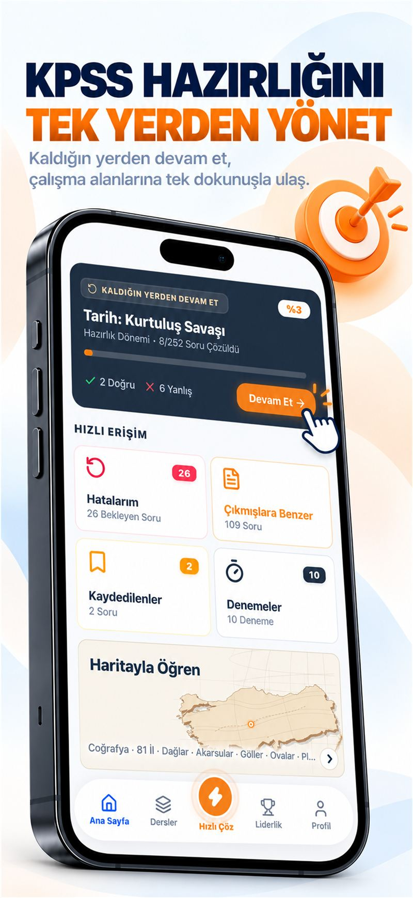&nbsp;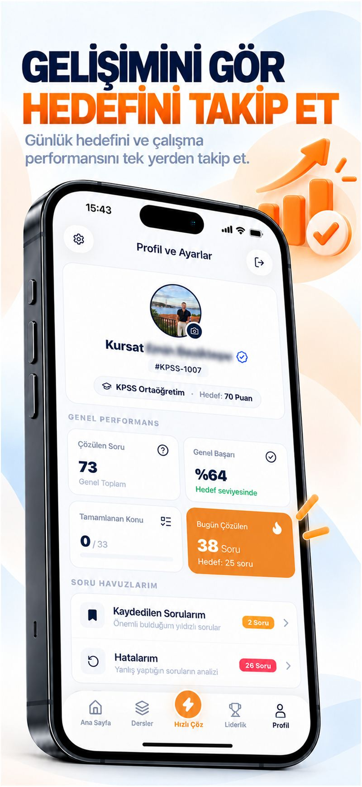

**iPhone & Android · Telefon & tablet · Türkçe deneyim**

---

## 🎯 Bir soru uygulamasından daha fazlası

Çalışmaya ayırdığın zamanda ne çözeceğini bulmak, yanlışlarını yeniden toplamak veya nerede kaldığını hatırlamak zorunda kalma. **KPSSODAK**, çalışacağın konuyu seçmekten sonucunu değerlendirmeye kadar hazırlık sürecini bir bütün olarak ele alır.

Konu konu ilerle; ihtiyaç duyduğunda karışık çöz. Yanlışlarını özel bir teste dönüştür. Denemede kendini ölç, coğrafyayı haritada çalış ve günlük hedefinle düzenini koru.

**Bu depo, portföy amaçlı ürün tanıtımıdır.** Aşağıda uygulamanın kullanıcı deneyimini bulabilirsin. Kaynak kodu, özel proje belgeleri ve üretim ayarları paylaşılmaz; teknik merakın için ayrı bir [mimari özeti](docs/architecture.md) vardır.

## 📚 01 — Ne çalışacağını bilerek başla

**Tarih, Coğrafya, Türkçe, Matematik, Vatandaşlık ve Güncel Bilgiler** çalışma alanlarını ders → konu → alt konu düzeninde keşfet. İlerleme göstergeleri, tamamladığın ve sıradaki başlıkları görmeni sağlar.

- **Ana sayfa:** Çözülen soru, doğru–yanlış ve başarı özetini bir arada gör.
- **Kaldığın yerden devam:** Son çalışmana geri dön; yeniden konu arama.
- **Konu veya karışık çözüm:** Tek başlığa odaklan ya da çalışma alanını genişlet.
- **Hızlı çözüm:** Cevaplamadığın sorularla pratiğe başla.
- **Sınav ve yıl filtreleri:** Hedefine uygun içerikleri daralt; ilgili havuzda sorusu bulunan yılları ve adetlerini gör.
- **Çıkmışlara benzer sorular:** Sınav tarzında hazırlanmış çalışma içeriklerini keşfet.

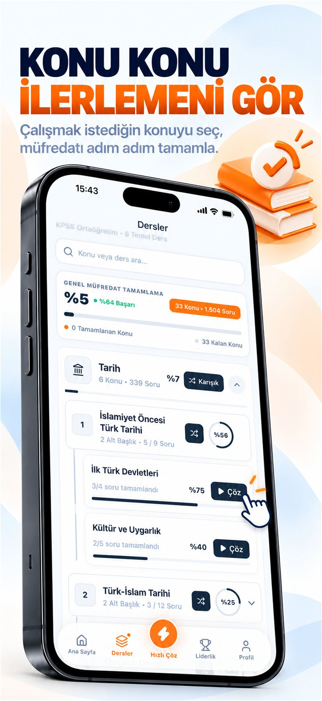&nbsp;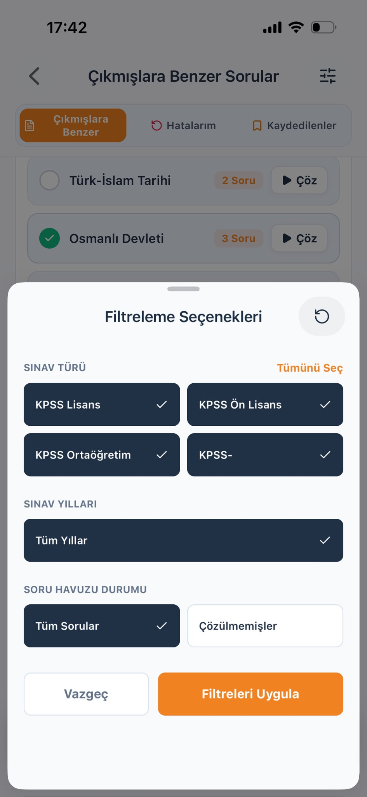

## 💡 02 — Cevabı işaretle, mantığını öğren

Normal soru çözümünde yanıtının sonucunu gör; açıklamayı açarak çözümün nedenini incele. Sorular arasında numaralı alanla ilerle, tekrar dönmek istediklerini kaydet.

**Soru istatistikleri**, doğru çözülme oranını ve seçeneklere verilen cevapların dağılımını gösterir. Böylece yalnız kendi yanıtını değil, sorunun genel olarak nerede zorlayıcı olduğunu da değerlendirebilirsin.

- Soru kökü, seçenekler ve açıklamalı çözüm aynı çalışma akışında.
- Kalın/italik vurgular, görseller ve desteklenen matematiksel gösterimler.
- Soru numaralarıyla gezinme ve çözülen soruların durumunu takip etme.
- Kaydetme, çözümü inceleme ve hatalı soruyu bildirme.
- Oturum sonunda çalışma özeti ve sorulara yeniden dönme.

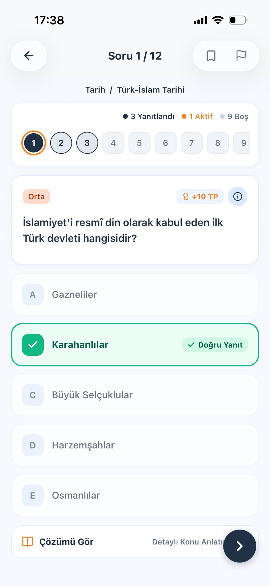&nbsp;

## 🔁 03 — Yanlışlarını bir sonraki çalışmana dönüştür

**Hatalarım**, yanlış yanıtladığın soruları ders ve konu bazında bir araya getirir. **Kaydedilenler**, tekrar dönmek istediğin sorular için kişisel alanındır.

**Özel Test Oluştur** ile farklı başlıkları birleştir; seçtiğin konulara, hatalarına veya kaydettiklerine odaklanan bir çalışma hazırla. Aynı geniş havuzda dolaşmak yerine ihtiyacın olan sorularla çalış.

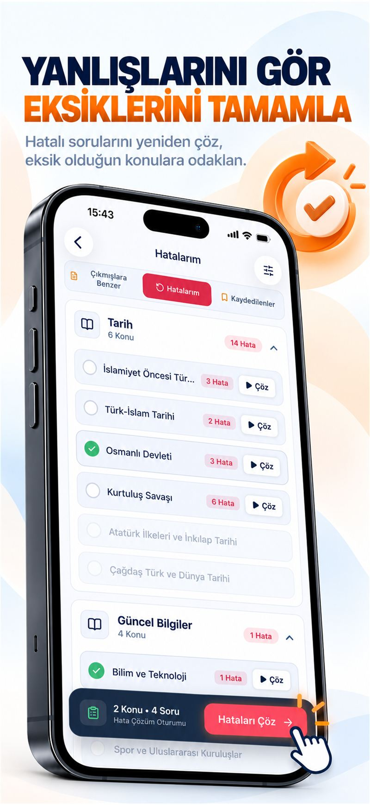&nbsp;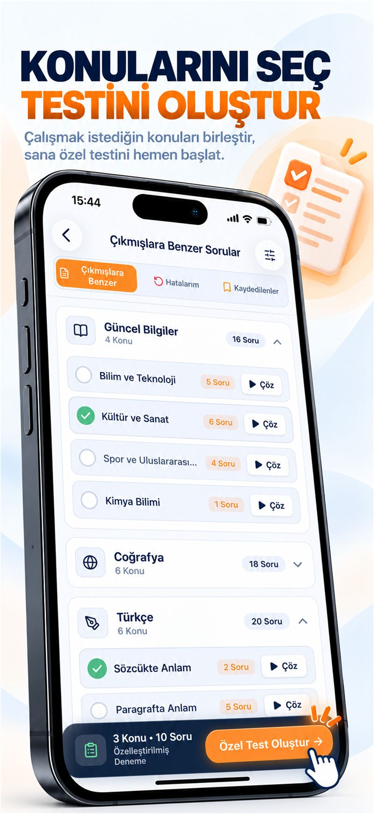

## ⏱️ 04 — Sınavdan önce kendini dene

**Genel ve branş denemeleriyle** bütün sınavı ya da tek bir dersi çalış. Süreli modda zaman yönetimini dene; süresiz modda öğrenmeye odaklan.

- Deneme kataloğunda içerikleri ve önceki performansını incele.
- Sorular arasında ilerle; boş bıraktıklarını kontrol et.
- Sonuçta **doğru, yanlış, boş, net ve ders bazındaki performansını** gör.
- İnceleme ekranında soru numaralarının durumlarından yararlan; yanıtlarına ve izin verilen çözümlere geri dön.
- Çözüm ve istatistik erişimi, içeriğin ve hesabının haklarına göre sunulur.

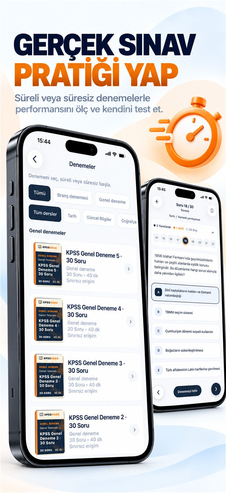

## 🗺️ 05 — Coğrafyayı okuyarak değil, yerini bularak da öğren

Türkiye haritası üzerinde **81 ili** çalış. Dağ, akarsu, göl, ova, plato ve diğer coğrafya kategorilerinde hedefleri keşfet; ilgili etkinlikte cevap kartını doğru konuma sürükleyip bırak.

Haritayı yakınlaştır, gez ve ayrıntılara odaklan. Tur içindeki doğru–yanlışlarını ve ilerlemeni gör; öğrenmek istediğin kategoriyi seçerek pratiğini sürdür. Kategoriye göre bilgi notları, il adları ve komşu ülke görünümü çalışmanı destekler.

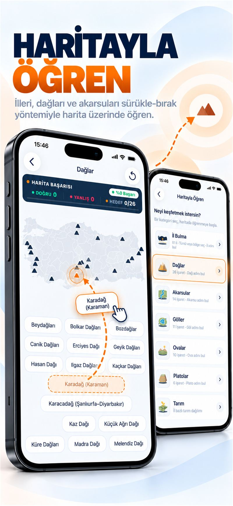&nbsp;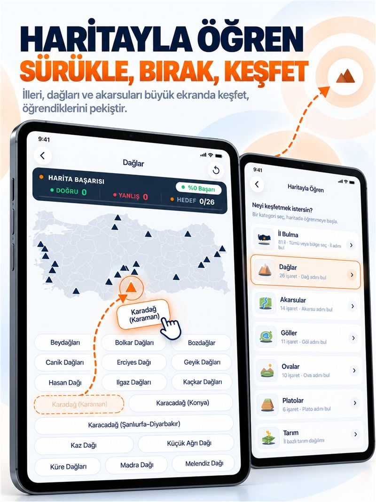

## ✍️ 06 — Düşünceni sorunun üzerine taşı

Desteklenen tablet modunda sorunun üzerine işlem yap, önemli yerleri vurgula ve kendi notlarını bırak. **Kalem, fosforlu kalem, silgi, renk ve kalınlık** araçlarıyla çalışma alanını ihtiyacına göre kullan. Gezinme modunda soru kâğıdını taşı ve yakınlaştır.

Karalamalar cihazda saklanır; aynı soruya döndüğünde notlarına yeniden ulaşabilirsin. Açıklamayı soru ile birlikte incelemek, özellikle işlem gerektiren konularda çalışma akışını bir arada tutar.

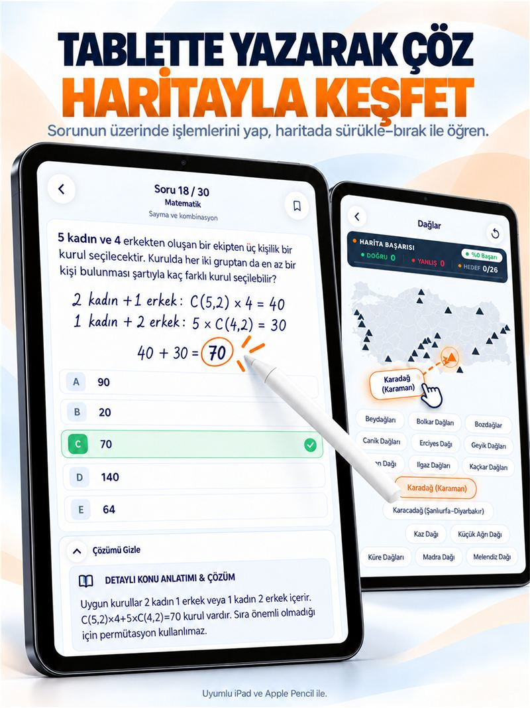

> Kalem, parmakla yazma ve çoklu dokunma davranışları cihaz ve uygulama sürümüne bağlıdır. Görseller kullanım örnekleridir; her sürümde aynı araç ve jest desteği sunulduğu anlamına gelmez.

## 🔥 07 — Bir günlük motivasyonu çalışma düzenine çevir

**Günlük hedefini belirle**, gün içinde ne kadar ilerlediğini takip et. Çalışma serisi ve takvim, aktif olduğun günleri görünür kılar; uygun hakların varsa seri dondurma seçeneklerini de yönetebilirsin.

**Liderlik**, haftalık ve tüm zamanlar sıralamasında yerini görmeni sağlar. TP puanınla gelişimini takip et; puanlama kurallarıyla doğru pratiğe odaklan. Yanlış cevap puan kesintisinde toplam puan sıfırın altına düşmez.

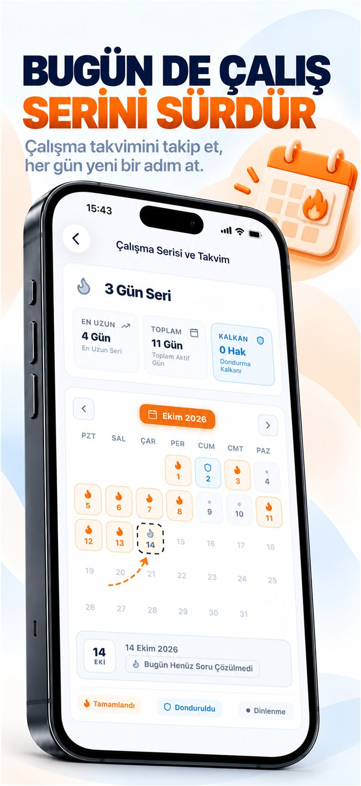&nbsp;

## 🧭 08 — Hazırlığının diğer parçaları da yanında

**Sınav takvimi** yaklaşan sınavları ve tarihlerini takip etmene yardımcı olur. **Profil ve Ayarlar** üzerinden günlük hedefini, sınav tercihini, görünümünü ve hesap bilgilerini yönetebilirsin.

- **Açık ve koyu tema:** Çalışma ortamına uygun görünüm.
- **Hesap ve giriş:** E-posta/şifre ile giriş, desteklenen Apple ve Google giriş seçenekleri, hesap yönetimi.
- **Üyelik:** Paketlerini, Premium erişimini ve abonelik durumunu inceleme; uygun erişim kodlarını kullanma.
- **Destek:** Uygulama içinden destek talebi ve soru hatası bildirme.
- **Güncelleme:** Uyumlu uygulama içi güncellemeleri denetleme; gerektiğinde mağazadaki yeni sürüme geçme.
- **Kişisel takip:** Kaydedilenler, hatalar, günlük hedef ve genel performansa aynı profilden ulaşma.

Özellik ve içerik erişimi seçilen paket, içerik ayarları ve uygulama sürümüne göre değişebilir. Ekranlardaki kişi, sayı ve katalog bilgileri görsellerin hazırlandığı döneme aittir.

## 🖥️ Öğrenci deneyimini besleyen yönetim paneli

Mobil uygulamanın arkasında, yönetici ve eğitmenlerin içerikleri yönetebildiği bir web paneli bulunur. Bu, öğrencinin gördüğü ders, soru, harita ve deneme deneyiminin yönetim tarafıdır.

**İçerik:** Ders–konu–alt konu düzeni, soru bankası, biçimlendirme ve mobil önizleme, soru görselleri, açıklamalar, denemeler ve sınav takvimi.

**Haritalar:** Kategori kartları, ortak harita görünümü, noktaların konumlarını sürükleyerek düzenleme, yeni hedef ekleme, bilgi ve görünüm ayarları, aktif/pasif ve erişim yönetimi.

**Operasyon:** Kullanıcı ve roller, üyelikler, paket hakları, erişim kodları, satışlar, soru bildirimleri, destek talepleri, liderlik/seri ayarları ve işlem geçmişi.

<strong>Yönetim panelinin örnek görünümünü aç</strong>

 
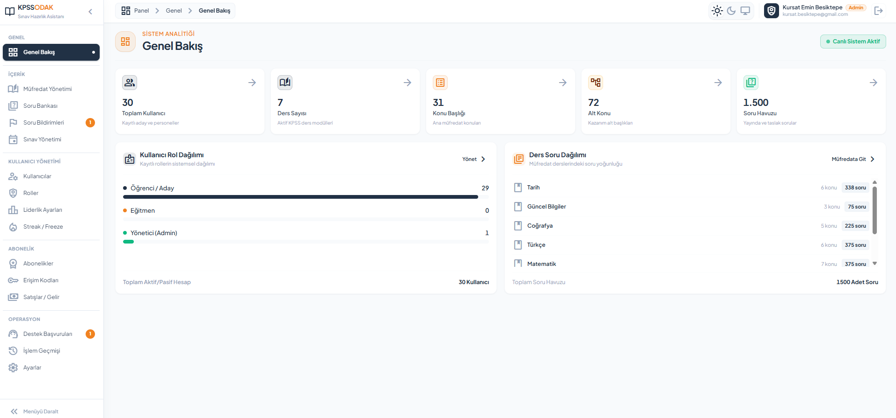

*Görsel, ürünün yönetim deneyimini tanıtır; özel yönetim erişimi veya proje dosyası paylaşılmaz.*

---

## ⚙️ Teknik tarafı merak edenlere

Mobil uygulama, yönetim paneli ve ortak servislerin nasıl bir araya geldiğini ayrı, kısa bir belgede okuyabilirsin.

**[Ürün mimarisi ve kullanılan teknolojiler →](docs/architecture.md)**

Kurulum rehberi, özel kaynak kodları, çalışma notları, erişim bilgileri ve iç operasyon belgeleri bu tanıtım deposunun kapsamı dışındadır.

### Küçük bir çalışma. Görünür bir ilerleme.

**[KPSSODAK’ı keşfet →](https://kpssodak.runasp.net/)**

Bağımsız bir sınav hazırlık projesidir; ÖSYM ile resmî bağlantısı yoktur. “Çıkmışlara benzer” ifadesi birebir geçmiş sınav sorusu anlamına gelmez.

