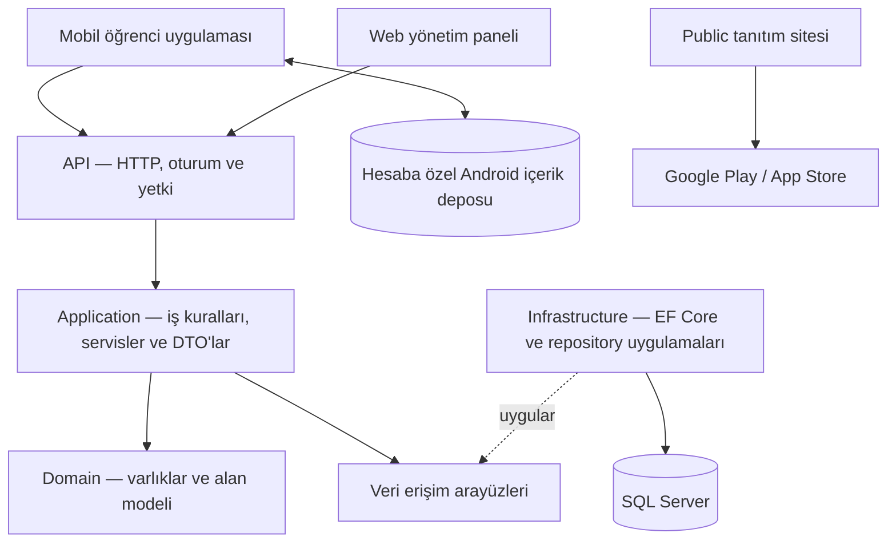
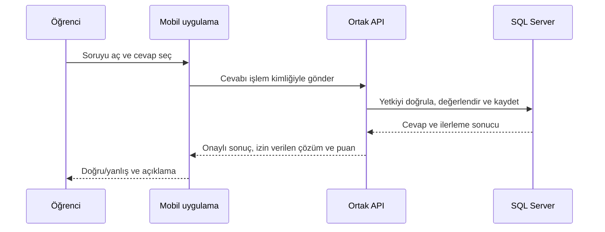

# KPSSODAK — Ürün altyapısı ve güncel mimari

Bu belge, 28 Ekim 2026 tarihli kaynak ve özellik belgelerine göre ürünün altyapısını özetler. Ana [README](../README.md) kullanıcı tanıtımıdır. Bu depo tanıtım ve görsel varlıkları içerir; uygulamanın kaynak kodunu, üretim yapılandırmasını veya kurulum paketini yayımlamaz.

## Ürünün parçaları

| Parça | Sorumluluk | Teknoloji |
| --- | --- | --- |
| Mobil öğrenci uygulaması | Soru çözümü, deneme, harita, kalem, ilerleme ve paket ekranları | React Native, Expo, TypeScript, Expo Router |
| Web yönetim paneli | Müfredat, soru, deneme, harita, takvim, erişim ve operasyon yönetimi | React, Vite, TypeScript, Tailwind CSS |
| Public tanıtım sitesi | Özellik tanıtımı, mağaza bağlantıları, destek ve yasal bilgi sayfaları | Ayrı React/Vite girişi |
| Ortak backend | Oturum, yetki, değerlendirme, ilerleme, içerik ve satın alma doğrulaması | ASP.NET Core 9, C#, Entity Framework Core |
| Kalıcı sunucu verisi | İçerik, hesap, cevap geçmişi, deneme oturumları ve erişim kayıtları | SQL Server |
| Android içerik deposu | Desteklenen istemcilerde doğrulanmış, değişmeyen içerik gövdelerinin sınırlı yerel saklanması | SQLite |

## Korunan dört katman

`backend/` API / Application / Domain / Infrastructure yapısını korur. Yönetici istemcisi `frontend/`, öğrenci istemcisi `mobile/` altında kalır. Gerçekten ortak platform bağımsız yardımcılar `shared/` içinde tutulur; web bileşenleri React Native'e doğrudan taşınmaz. Yeni bir monorepo veya farklı bir sunucu mimarisine geçiş yapılmamıştır.

## Güncel içerik okuma ve eşitleme

Önceki yalnız bellek önbelleğine ek olarak, destekleyen Android sürümlerinde **hesaba özel ve kapasitesi sınırlı SQLite içerik deposu** vardır. Genel erişim sunucuda etkinleştirilmiştir; kullanım istemcinin gerekli native modülü ve okuma yeteneğini bildirmesine bağlıdır. iOS ve web bu Android deposunu kullanıyor sayılmaz; eski istemcilerin mevcut API yolu korunur.

1. İstemci güncel oturum ve erişim bağlamıyla içerik ister.
2. Sunucu kullanıcının yetkisini ve istenen içerik sürümünü doğrular.
3. Değişmeyen gövde yerelde doğrulanabiliyorsa tekrar aktarılmaz; eksik veya değişmiş içerik sınırlı sayfalarla alınır.
4. Statik içerik ile güncel erişim, ilerleme, cevap ve deneme oturumu bilgileri ayrı değerlendirilir.
5. Hesap veya erişim değiştiğinde eski istekler yeni bağlama uygulanmaz. Bozuk içerik kontrollü olarak yeniden alınır; kapasite/disk hatasında doğrulanmış ağ yanıtı kullanılabilir.

Bu yaklaşım soru gövdeleri, katalog, harita, deneme ve izin verilen çözüm okumalarını kapsar. Bütün sorular ve cevap anahtarları açılışta indirilmez. Çözüm açma izni sunucudan alınır; yerel veri paket hakkı veya çözüm kotası vermez. Filtreler bu kalıcı gövde saklama kapsamına dahil değildir.

**Tam çevrimdışı soru çözümü değildir.** Cevap değerlendirmesi, paket/çözüm hakkı, puan ve deneme süresi sunucunun sorumluluğundadır. Daha az veri aktarılması, bütün cihazlarda ölçülmüş bir hız veya bellek kazancı anlamına gelmez.

## Tekrarlanan istekleri azaltan ortak okuma

Ders/konu, harita ve küçük politika okumaları aynı sınırlı bellek önbelleğini paylaşır. Eşzamanlı aynı istekler birleştirilir; hata sonucu kalıcı başarı olarak saklanmaz. Uzun listeler sanallaştırılır ve ilgili akışlarda sayfa sayfa yüklenir. Soru çözümünde yakın sayfa/görseller önceden hazırlanır; gereksiz bütün-havuz indirmesi yapılmaz.

Paket ve içerik erişim değişiklikleri mevcut bildirim bağlantısıyla istemciye iletilir; istemci ilgili okumaları yeniler. Bağlantı kesilmesi, yeniden odaklanma ve normal süre sonu yenilemeleri ayrı ele alınır. Bu bildirim mekanizması sunucudaki yetki kontrolünün yerine geçmez.

## Soru, cevap ve deneme akışı

Şık seçimi hemen görünür; doğru/yanlış ve puan sunucu onayını bekler. Tekrarlanan aynı gönderim ikinci ödül üretmez. Genel pratik ile deneme oturumu ayrı tutulur. Denemeler başladıkları içerik sürümünü korur; inceleme için sahiplik, tamamlanma ve çözüm gösterme izni gerekir.

## Soru üzerine yazma

Android Ink ve iOS PencilKit ortak soru çalışma alanına bağlıdır. Not kimliği hesap, soru veya deneme girişimi ve içerik sürümüyle ilişkilendirilir. Mürekkep cihazdaki dosyalarda tutulur; sunucudaki cevap/ilerleme verisiyle karıştırılmaz ve buluta eşitlenmez. Kaydetme hatası normal soru geçişini durdurabilir; denemenin sunucu süresini uzatmaz.

Kalem/parmak kullanımı ve araçlar platform, donanım ve native pakete bağlıdır. Kaynakta bulunan yeni iOS geri alma düzeltmesi yeni native build ve cihaz doğrulaması gerektirir; yalnız uygulama içi güncellemeyle uygulanmış sayılmaz.

## Takvim, açılış ve güncellemeler

- **Sınav takvimi:** Aktif takvimler ortak sırayla sunulur; mobil hedef seçimi yalnız eski sabit türlerle sınırlanmaz. DGS dahil yeni adlar aynı akışa katılır. Son başarılı takvim korunur, ekran yeniden aktifleştiğinde güncel veri istenir. Tahmini tarih kesin tarih gibi sunulmaz.
- **Ortak marka açılışı:** Mobil ve public web, aynı vektör modeline dayalı açılış kullanır. Android çizim yükünü azaltan düzenleme mevcut görsel kimliği korur. Yerel hesaplama ölçümleri gerçek cihaz FPS kabulü değildir.
- **Güvenli uygulama güncellemesi:** Uyumlu paketler açılıştaki hazır olma kapısından geçer. Aktif soru, deneme veya çizim sırasında kendiliğinden yeniden başlatma yapılmaz. Native modül değişikliği yeni mağaza paketi gerektirir.

## İşletim ve güvenlik

API/SQL kaynak gözlemi ve hata/çökme inceleme alanları yönetim panelinde ayrı sorumluluklardır. Kullanıcı ekranları ham HTTP/native hata ayrıntılarını göstermez. Hata sağlayıcılarının sembol, yetki ve mağaza bağlantılarının kurulması ayrı koşullardır; panel bulunması bütün dış sağlayıcıların tamamlandığı anlamına gelmez.

Oturum bilgileri native güvenli depoda tutulur. Satın alma makbuzunu ve paket erişimini backend doğrular. Yönetici rolü ile öğrencinin abonelik hakkı ayrı kararlardır. Yerel içerik ve bildirim bağlantısı, bu güvenlik sınırlarını değiştirmez.

## Yayın ve doğrulama sınırları

28 Ekim itibarıyla takvim ve ortak açılış iyileştirmeleri uyumlu production uygulama güncellemeleriyle yayımlanmıştır. Android içerik eşitleme genel aktivasyonu sunucuda açıktır; gerçek kullanım uyumlu uygulama paketine bağlıdır. Genel matematik sığdırma ve iOS native çizim geçmişi gibi kaynak geliştirmeleri, ilgili yayın ve cihaz kabulü tamamlanmadan mevcut bütün kurulumlarda varmış gibi tanıtılmaz.

Bu tanıtım deposunda sunucu adresleri dışında üretim ayarları, hesap kimlikleri, anahtarlar, parolalar veya işletim logları paylaşılmaz.
